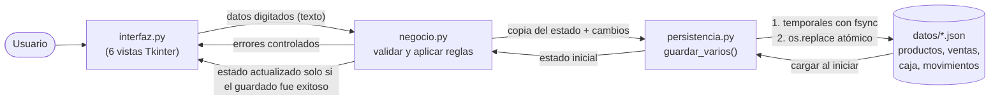

# Sistema de Gestión de Supermercado

Proyecto final de Programación I desarrollado en Python.

## Tecnologías

- Python
- Tkinter
- JSON

# Manual breve de usuario

> Las capturas de pantalla deben tomarse al ejecutar `python main.py` en su equipo (marcadas con **[CAPTURA]** en cada sección).

## 0. Iniciar

1. (Opcional, para la demostración) `python generar_datos_ejemplo.py`.
2. `python main.py`. Se abre la ventana con seis pestañas. La caja queda cerrada: **abra la caja antes de vender**.

## 1. Caja (pestaña "Caja")  **[CAPTURA]**

- **Abrir caja:** escriba el saldo inicial y pulse *Abrir caja*.
- **Ingreso / egreso:** elija el tipo, monto y descripción, luego *Registrar movimiento*. Un egreso no puede superar el efectivo en caja.
- **Cerrar caja:** escriba el efectivo contado en *Efectivo declarado* y pulse *Cerrar caja*. El sistema muestra esperado, declarado y la diferencia exacta (negativa = faltante, positiva = sobrante).

## 2. Productos (pestaña "Productos")  **[CAPTURA]**

- **Registrar:** complete el formulario y pulse *Registrar nuevo*. El código es único y no admite espacios.
- **Buscar:** use el cuadro *Buscar* (código, nombre o categoría).
- **Editar:** seleccione un producto, cambie los campos y pulse *Guardar cambios*. El código y la existencia no se editan aquí.
- **Desactivar / reactivar:** seleccione y pulse el botón. Un producto desactivado no se puede vender, pero se conserva en el historial.
- Las filas rojas indican stock bajo (≤ mínimo); las grises, productos desactivados.

## 3. Inventario (pestaña "Inventario")  **[CAPTURA]**

Elija el producto, el tipo (entrada o salida), la cantidad y un motivo; pulse *Registrar*. Una salida mayor a la existencia se rechaza. La tabla de alertas muestra los productos con existencia ≤ stock mínimo, y debajo está el historial de movimientos (incluye ventas y devoluciones).

## 4. Ventas (pestaña "Ventas")  **[CAPTURA]**

1. Seleccione un producto de la lista izquierda, indique la cantidad y pulse *Agregar al carrito*.
2. En el carrito puede *Retirar*, *Cambiar cantidad a:* o *Vaciar*.
3. Escriba el descuento (%) y el pago recibido; los totales y el cambio se calculan en pantalla.
4. Pulse **COBRAR**. Se genera la factura consecutiva (F-000001...), baja el stock y se registra el cobro en la caja.

Se rechazan: cantidades inválidas, ventas mayores a las existencias, pagos insuficientes, descuentos fuera de rango y ventas con la caja cerrada.

## 5. Facturas y devoluciones  **[CAPTURA]**

- Busque por número (acepta `F-000003` o `3`) o seleccione en el historial.
- Seleccione el producto en el detalle, indique la cantidad y un motivo, y pulse *Registrar devolución*.
- No se puede devolver más de lo vendido. La devolución reintegra existencias, actualiza el estado de la factura (`devuelta parcial` / `devuelta total`) y descuenta el efectivo de la caja.

## 6. Reportes  **[CAPTURA]**

Indique las fechas (AAAA-MM-DD) y pulse *Consultar*: facturas, unidades netas, ventas brutas, devoluciones, ingresos netos y los productos más vendidos.

## Mensajes de error frecuentes

| Mensaje | Qué hacer |
|---|---|
| "Debe abrir la caja antes de vender" | Abra una sesión en la pestaña Caja. |
| "Existencias insuficientes..." | Reduzca la cantidad o registre una entrada de inventario. |
| "Pago insuficiente..." | Digite un pago mayor o igual al total. |
| "Ya existe un producto con código..." | Use otro código o edite el existente. |
| "El archivo ... está dañado" | Restaure una copia del JSON o regenere con `generar_datos_ejemplo.py --forzar`. |


# Diagrama de flujo de datos

## Vista general



## Flujo de una venta

```mermaid
sequenceDiagram
    participant V as Vista Ventas
    participant C as Carrito
    participant T as Tienda (negocio)
    participant D as persistencia
    V->>C: agregar(código, cantidad)
    C-->>V: ok o ErrorNegocio (stock, inactivo)
    V->>T: cobrar(carrito, descuento, pago)
    T->>T: validar descuento, pago, caja abierta, stock
    T->>T: copia del estado: baja stock, factura F-000001, movimiento de caja
    T->>D: guardar_varios(productos, ventas, caja, movimientos)
    alt todo se escribió bien
        D-->>T: ok
        T-->>V: factura (estado en memoria actualizado)
    else falla escritura o reemplazo
        D-->>T: ErrorPersistencia (originales intactos)
        T-->>V: error; memoria y carrito sin cambios
    end
```

## Esquema ASCII

```
Usuario -> interfaz.py -> negocio.py -> persistencia.py -> datos/*.json
              ^               |               |
              |_______________|_______________|
        mensajes de error / resultado de la operación

        # Sistema de Gestión de Supermercado

Aplicación para administrar las operaciones de un supermercado: productos, inventario, ventas y clientes.

## Características

- Registro, edición y eliminación de productos
- Control de inventario y stock mínimo
- Registro de ventas y generación de facturas
- Gestión de clientes y proveedores
- Reportes de ventas

## Tecnologías

- Lenguaje: (por ejemplo, Python / Java / C# / JavaScript)
- Base de datos: (por ejemplo, MySQL / SQLite / archivos)
- Otras herramientas: (frameworks o librerías)

## Requisitos

- (Versión del lenguaje, por ejemplo Python 3.11)
- (Dependencias, por ejemplo `pip install -r requirements.txt`)

## Instalación y ejecución

1. Clona el repositorio:
   ```bash
   git clone https://github.com/carendurangom-ux/SISTEMAVDE-GESTION-DE-SUPERMERCADO.git
   cd SISTEMAVDE-GESTION-DE-SUPERMERCADO
   ```
2. Instala las dependencias.
3. Ejecuta el programa:
   ```bash
   (comando para iniciar tu sistema)
   ```

## Estructura del proyecto

(Lista breve de carpetas y archivos principales)

## Autora

Karen Durango

## Arquitectura

El sistema usa una **arquitectura monolítica en capas**: una sola aplicación en Python, ejecutada desde `main.py`, donde todos los módulos se despliegan juntos.

| Capa | Responsabilidad |
|------|-----------------|
| Interfaz | Interacción con el usuario |
| Negocio | Lógica de productos, inventario, ventas y caja |
| Persistencia | Lectura y escritura de datos en archivos JSON |

**Flujo:** Interfaz → Negocio → Persistencia → archivos JSON.

**Ventajas de este enfoque:** es simple de desarrollar, probar y ejecutar, ideal para un sistema de este tamaño.

## Estado del proyecto

🚧 En desarrollo. La estructura de capas ya está definida; los módulos se están implementando.

## Módulos planeados

- **Productos:** registro, consulta, edición y eliminación.
- **Inventario:** control de existencias.
- **Venta:** registro de ventas.
- **Caja:** control del dinero de la caja.